# ZEFLibrary - Aplikasi Pemesanan Buku (UTS Pemrograman Web 1)

Aplikasi web front-end sederhana untuk pemesanan buku pada toko online. Dibangun hanya dengan **HTML, CSS, dan JavaScript** (tanpa framework dan tanpa server). Seluruh data berasal dari variabel JavaScript pada `js/data.js` (`dataPengguna`, `dataKatalogBuku`, `dataTracking`) yang diberikan dosen.

## Informasi Mahasiswa

| | |
|---|---|
| Nama | *(Nurfaiz Pradibto Nugroho)* |
| NIM | *(312510172)* |
| Kelas | *(I253C)* |
| Mata Kuliah | Pemrograman Web 1 |

## Tautan

- **Repository:** *(isi link GitHub, pastikan public)*
- **Video penjelasan (YouTube):** *(isi link YouTube, pastikan public/unlisted dapat diakses)*

## Cara Menjalankan

1. Unduh atau clone repository ini.
2. Buka file `index.html` di browser (Chrome, Edge, atau Firefox). Tidak perlu instalasi apa pun.
3. Login dengan salah satu akun dari `data.js`:
   - Email: `rina@gmail.com`, Password: `rina123` (User)
   - Email: `siti@gmail.com`, Password: `siti123` (Admin)
4. Nomor Delivery Order contoh untuk halaman tracking: `20230012` (Dalam Perjalanan) dan `20230013` (Dikirim/selesai antar).

## Struktur Folder

```
tugas-uts-web1/
|-- index.html        (halaman login)
|-- dashboard.html
|-- stok.html
|-- checkout.html
|-- tracking.html
|-- riwayat.html      (halaman tambahan: history transaksi)
|-- css/
|   |-- style.css
|-- js/
|   |-- script.js     (logika semua halaman)
|   |-- data.js       (data dummy dalam bentuk array JSON)
|-- assets/
|-- img/              (gambar sampul buku)
|-- screenshots/      (tangkapan layar untuk README)
```

## Pemenuhan Indikator Penilaian

| Indikator | Penerapan |
|---|---|
| HTML semantik, valid, lengkap | Memakai `header`, `nav`, `main`, `section`, `footer`, `table` (`thead`/`tbody`), `dl`, `label for`, dan atribut ARIA pada modal |
| Desain CSS | Stylesheet eksternal `css/style.css`, CSS variables untuk tema, CSS grid/flexbox, responsif dengan media query |
| JavaScript DOM | Render tabel dinamis, tambah/hapus/ubah baris, modal, progress status pengiriman, pencarian |
| Validasi form dan alert | Pesan error di bawah input (`setError`), `alert` dan `confirm` untuk kesalahan dan konfirmasi |
| Modularitas file | Pemisahan HTML, CSS, data (`data.js`), dan logika (`script.js`) |
| Kreativitas | Tema modern ZEFLibrary (ilustrasi rak buku, gradasi teal-indigo, navbar kaca), pencarian katalog, nomor DO otomatis, riwayat transaksi, penyimpanan data via localStorage |

## Penjelasan Project dan Hasil Tangkapan Layar

### 1. Halaman Login (`index.html`)

Pengguna memasukkan email dan password. Validasi format email dilakukan dengan regex dan pesan error tampil di bawah kolom. Jika email atau password tidak sesuai dengan `dataPengguna`, muncul alert **"Email/password yang anda masukkan salah"**.

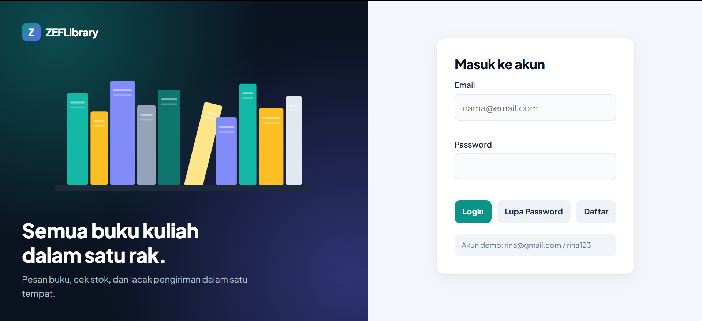

Validasi isian login (email tidak valid dan password kosong):

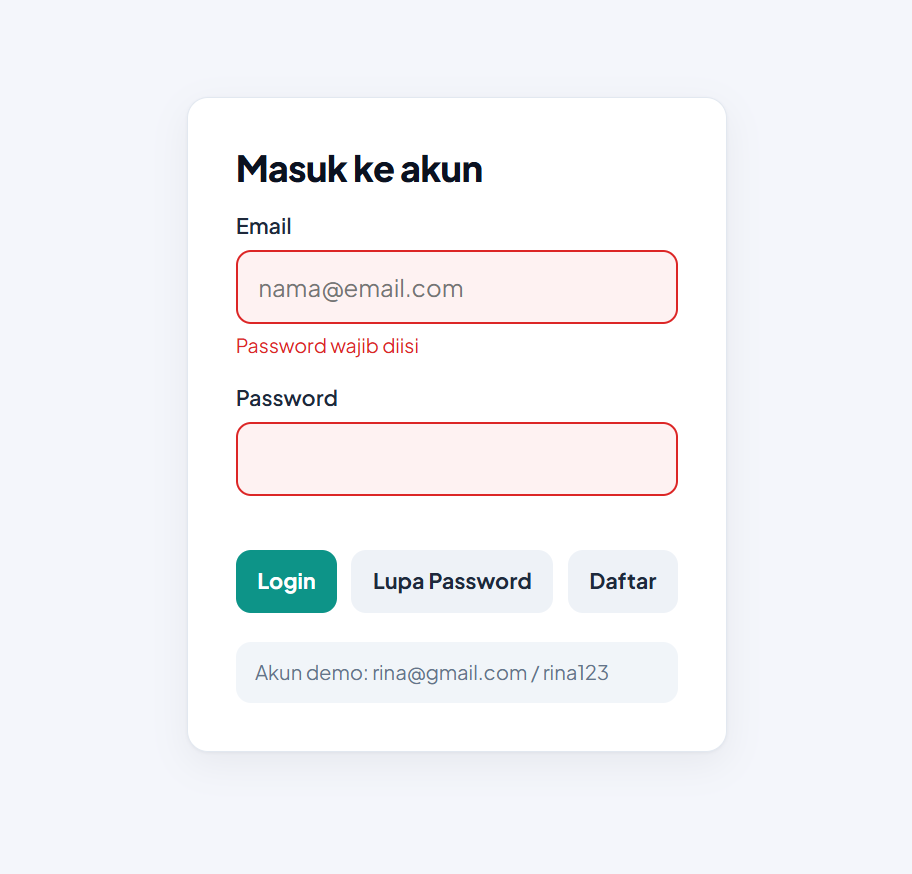

Tombol **Lupa Password** dan **Daftar** membuka modal box. Akun yang didaftarkan disimpan di localStorage dan bisa langsung dipakai login.

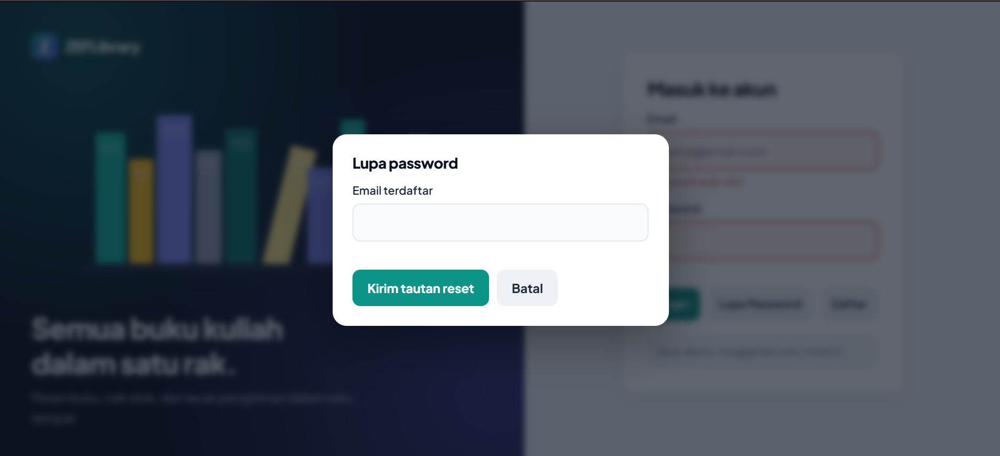

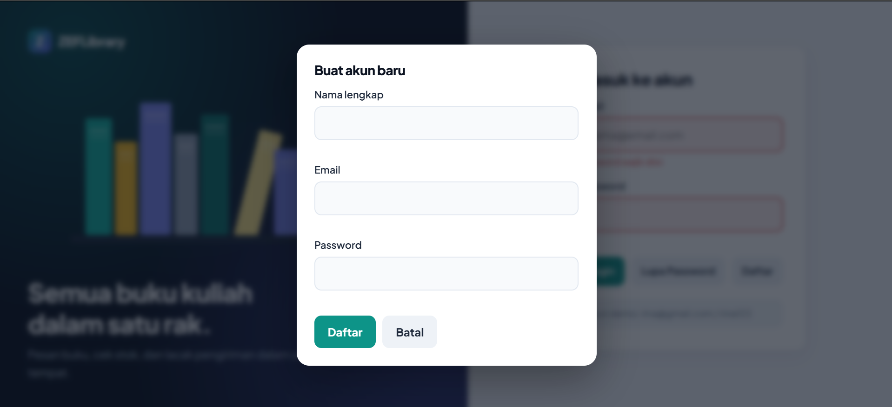

### 2. Dashboard (`dashboard.html`)

Menampilkan greeting sesuai jam lokal (`new Date().getHours()`): pagi (sebelum 11.00), siang (11.00-14.59), sore (15.00-17.59), malam (setelah 18.00). Terdapat empat tombol navigasi: Informasi Stok, Tracking Pengiriman, Laporan Pemesanan, dan History Transaksi.

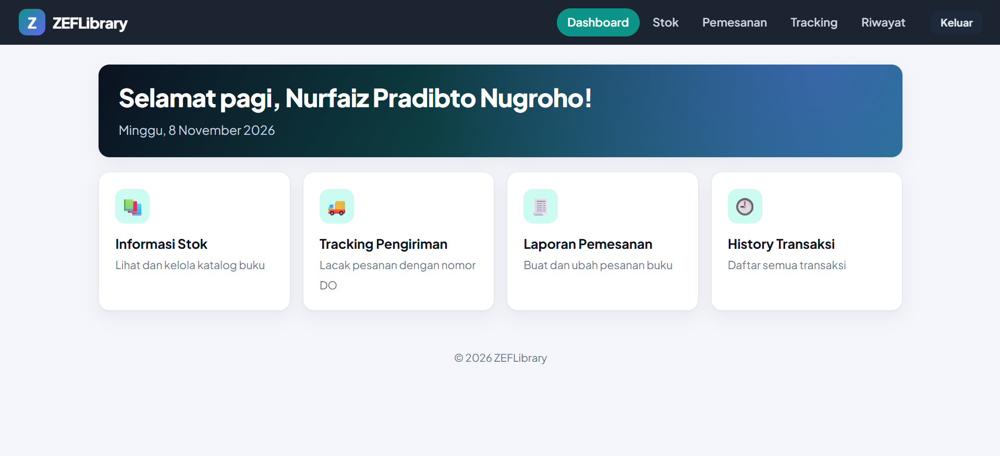

### 3. Informasi Stok / Katalog (`stok.html`)

Tabel (kode, nama barang, jenis, edisi, harga, stok, sampul) dibentuk secara dinamis dari variabel `dataKatalogBuku` di `js/data.js` memakai `document.createElement`. Fitur: pencarian, hapus baris, dan penambahan baris stok baru lewat form.

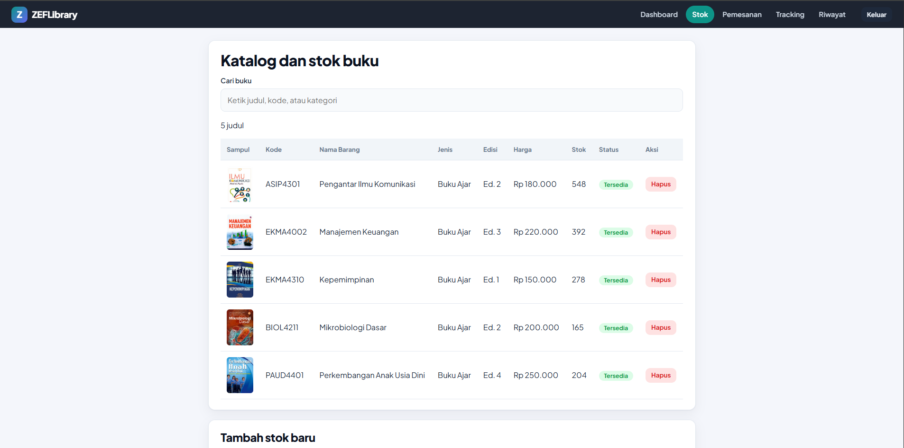

Validasi form tambah stok (kode, judul, kategori, harga, dan stok wajib valid; kode tidak boleh sama):

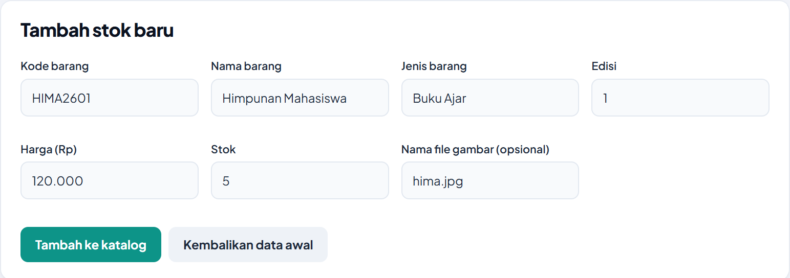

Hasil setelah menambahkan buku baru (baris baru muncul di tabel):

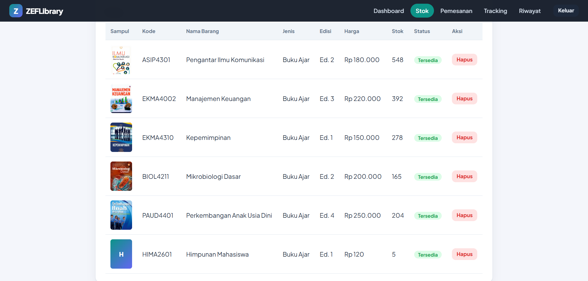

### 4. Pemesanan (`checkout.html`)

Pengguna memilih buku dan jumlah, lalu menambahkannya ke keranjang. Jumlah di keranjang dapat diubah dan baris dapat dihapus. Subtotal, ongkir, dan total dihitung otomatis. Jumlah pesanan dibatasi oleh stok.

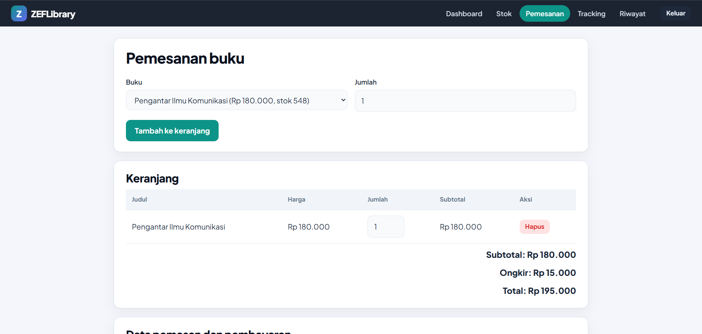

Form data pemesan dan pembayaran divalidasi (nama, email, telepon, alamat, metode pembayaran):

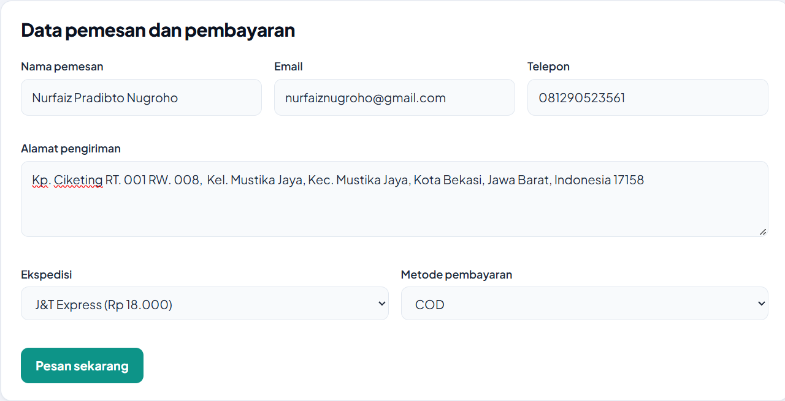

Jika valid, pesanan disimpan dan modal menampilkan nomor Delivery Order:

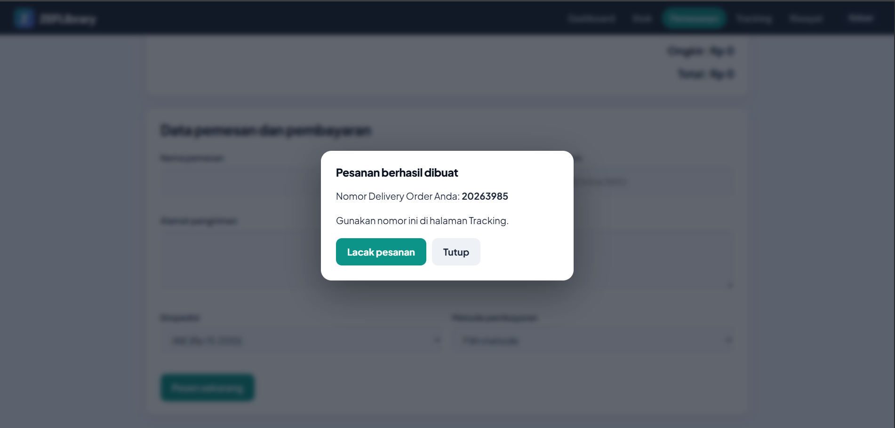

### 5. Informasi Pengiriman (`tracking.html`)

Input nomor Delivery Order. Data dibaca dari `dataTracking` berdasarkan nomor DO. Setelah tombol **Cari** ditekan tampil nama pemesan, status pengiriman (progress bar: Diterima, Di Hub, Dalam Perjalanan, Selesai Antar), ekspedisi, tanggal kirim, jenis paket, total pembayaran, dan tabel riwayat perjalanan paket. Nomor yang tidak ditemukan memicu alert.

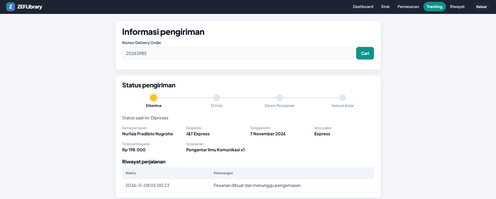

### 6. Riwayat Transaksi (`riwayat.html`)

Menampilkan seluruh transaksi, gabungan data `dataTracking` dan pesanan baru yang dibuat dari halaman pemesanan.

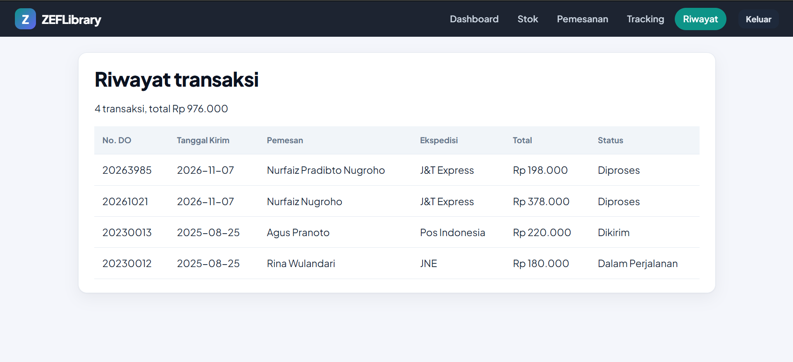

### 7. Informasi Akun dan Logout

Setelah login, navbar menampilkan tombol profil (inisial dan nama depan). Jika diklik, muncul modal **Informasi Akun** berisi nama, peran (User/Admin), email, dan waktu login. Data diambil dari `sessionStorage` yang disimpan saat login.

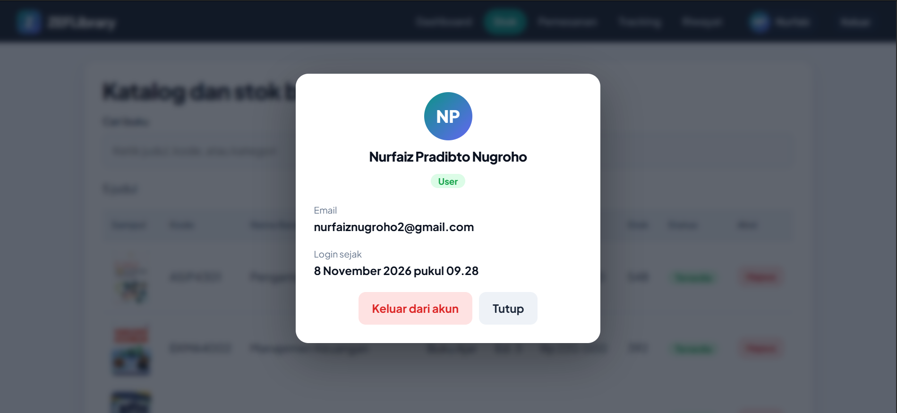

Tombol **Keluar** (di navbar maupun di modal akun) meminta konfirmasi, lalu menghapus sesi dan kembali ke halaman login. Setelah logout, membuka halaman lain langsung diarahkan ke login (proteksi halaman).

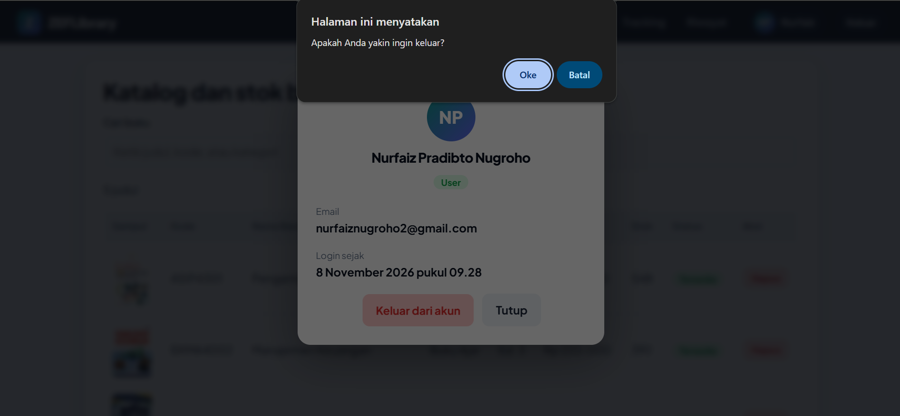

## Alur Berpikir Singkat

1. Menentukan data apa yang dibutuhkan (pengguna, katalog, pesanan) dan menyimpannya di `data.js`.
2. Merancang struktur HTML semantik untuk setiap halaman.
3. Membuat tema dan komponen bersama (tombol, tabel, modal) di satu `style.css` dengan CSS variables.
4. Menulis satu `script.js` yang memilih fungsi inisialisasi berdasarkan atribut `data-page` pada `<body>`, sehingga logika tidak terduplikasi.
5. Menambahkan validasi dan umpan balik error di setiap form.

## Catatan

- Aplikasi hanya front-end. Data tambahan (akun, katalog, pesanan) disimpan di localStorage browser dan tidak dikirim ke server.
- Autentikasi pada proyek ini hanya simulasi untuk keperluan belajar, bukan untuk produksi.
